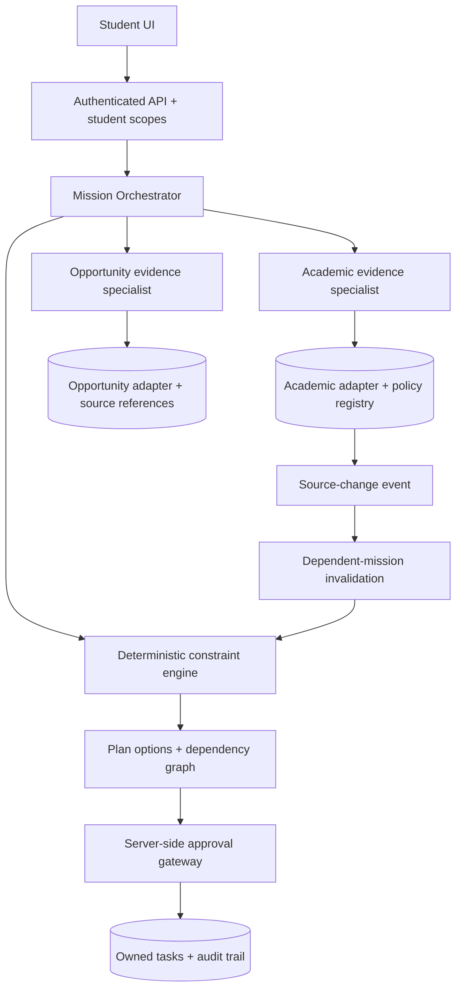

# 03 — Engineering design, contracts, agent boundaries, and security

## Build architecture recommendation: reliable single-repository app

**Primary recommendation:** Next.js 15+ App Router + TypeScript + Tailwind CSS + shadcn/ui components + Lucide icons + local SQLite (Prisma or Drizzle; choose ONE). Use Next.js server-side route handlers and server actions; avoid adding a second Python server overnight. Pure TS calculation functions and one optional real LLM adapter. For a future dedicated AI service, FastAPI/LangGraph is fine, but unnecessary for first submission.

**Why:** UI is the highest-priority deliverable. One Node deployment reduces integration failures. Attendance policy and replan pipeline can be pure tested TypeScript. Real LLM invocation can be added without changing component APIs.

Suggested structure:

```
/app
  /(product)/overview/page.tsx
  /(product)/decisions/page.tsx
  /(product)/agents/page.tsx
  /(product)/trust/page.tsx
  /api/students/me/route.ts
  /api/mission/evaluate/route.ts
  /api/mission/[id]/route.ts
  /api/mission/[id]/approve/route.ts
  /api/demo/source-change/route.ts       # dev/demo-only; NEVER enabled for real student data
  /api/trace/[runId]/route.ts
/components/{chrome,dashboard,decision,agent-trace,trust,ui}/
/lib/agents/{orchestrator,academic,opportunity,planner,model-adapter}.ts
/lib/core/{attendance,calendar,policy,evidence,dependencies,replan,permissions}.ts
/lib/db/{schema,seed,repo}.ts
/lib/contracts.ts
/tests/{attendance,authorization,replan,missions}.test.ts
/e2e/demo.spec.ts
/prototype                          # UNTOUCHED offline fallback supplied in kit
```

Needless library complexity is a risk. If a proper ORM cannot be set up quickly, use a tested SQLite client. No OAuth integration required for sample demo. No secrets on client. Use `env.example` with optional `LLM_API_KEY` and `LLM_MODEL`; no keys committed.

## Four layers



AI is allowed to **interpret, retrieve, synthesize**, but hard numerical constraints must be computed by `SOLVER`. Every output is schema validated. The LLM cannot call the database or web at unrestricted privilege.

## Core model contracts

```
type SourceKind = 'academic_simulator'|'student_import'|'official_event'|'manual'|'sample_policy';
type Verification = 'verified'|'unverified'|'synthetic'|'stale';
type EvidenceRef = {id:string;source:SourceKind;retrievedAt:string;verification:Verification;ownerId?:string;uri?:string;recordVersion:number};
type Mission = {id:string;studentId:string;goal:string;createdAt:string;revision:number;status:'evaluating'|'ready'|'needs_verification'|'approved'|'stale';sourceRefs:EvidenceRef[]};
type Course = {id:string;studentId:string;attended:number;total:number;futureScheduled:number;missesByOption:Record<string,number>};
type DecisionOption = {id:'full'|'partial'|'defer';attendanceProjections:Record<string,number>;hardViolations:string[];unknownConditions:string[];tasks:ActionDraft[];evidenceRefs:string[]};
type ActionDraft = {id:string;missionId:string;studentId:string;type:'create_local_task'|'create_local_calendar_block'|'draft_message';payload:unknown;requiresApproval:true;status:'draft'|'approved'|'executed'|'rejected';revision:number};
type TraceEvent = {id:string;missionId:string;actor:string;tool?:string;startAt:string;endAt?:string;status:'started'|'succeeded'|'failed';mode:'live_llm'|'deterministic';evidenceRefs:string[];error?:string};
```

Use ISO 8601 timestamps with explicit offsets and `Asia/Kolkata` timezone; never parse date-only strings as UTC and shift times. All source records carry as-of timestamp, provenance, and version; all plans pin versions of the inputs used.

## Mathematical core

Assumptions: existing attended count A, completed sessions T, H *future actual scheduled class meetings*, and M future missed because of participation. All other H−M classes are attended:

`projected_attendance_percent = 100 × (A + H − M) / (T + H)`

Guardrails: `T >= 0`, `0<=A<=T`, `H>=0`, `0<=M<=H`. If T+H=0, return `UNKNOWN`, not NaN. Different absences must also be incorporated; do not use event miss counts as total future absences unless the assumption is explicitly set.

For sample Network Security 21/27, four future classes:
- full (miss 2) = 23/31 = **74.1935%**;
- partial (miss 1) = 24/31 = **77.4194%**;
- defer (miss 0) = 25/31 = **80.6452%**.

A 75% cutoff is **the demo's scenario configuration**, not a definitive VIT eligibility assertion. Published VIT guidance acknowledges rules/exceptions; full academic regulations, CGPA and official OD permissions must be verified for real advice. The engine's output has three states: `OK_NUMERIC_ONLY`, `NOT_OK_NUMERIC_ONLY`, `NEEDS_VERIFICATION`.

## Candidate decision policy
1. Create option facts; do not let LLM invent ones.
2. Calculate academic numbers and hard conflicts deterministically.
3. Attach missing/unknown conditions: event eligibility, source freshness, academic rule version, OD approval.
4. Reject options that violate **verified** hard constraints; rank remaining conditionally (soft preferences, study slots and opportunity fit).
5. Return explanation and sources in schema, explicitly separate facts from suggestions.
6. Generate only permission-safe drafts; no external write until user approval.

Avoid claiming OR-Tools is used unless installed and actually solving. For one 3-option mission, straightforward deterministic enumeration is simpler and reliable. Integrate OR-Tools later if scheduling becomes a real combinatorial optimization problem.

## Minimal backend API contracts

`GET /api/students/me` → fictional student summary with active source names and data as-of timestamp (server session decides owner; never accept owner ID from untrusted client).

`POST /api/mission/evaluate` body `{goal:string,opportunityId:string}` → `{missionId,revision,decisionOptions,traceEvents,mode,unknownConditions,evidenceRefs}`; mission owner comes from server authentication.

`GET /api/mission/:id` → record if owner matches server session; else 403.

`POST /api/mission/:id/approve` body `{revision:number,actionIds:string[]}` → atomically check owner and mission revision. On success persist approved task(s), record audit metadata and return committed state. Reject outdated approvals (`409 STALE_REVISION`), future forged IDs and cross-owner items (`403`).

`POST /api/demo/source-change` body `{event:'advance_assignment_deadline'}` → only available in isolated demo mode; update synthetic source record and version; emit `SOURCE_UPDATED`; find affected missions; recompute; bump revision; invalidate approvals; return before/after object.

`GET /api/trace/:runId` → read authenticated user's own events; redact sensitive fields.

`POST /api/demo/security-selftest` → gated to isolated sample environment; server attempts cross-owner read under `stu_maya_demo`, expects 403; returns sanitized result. Never reveal target data. This is optional and must not create a production data-access bypass.

## Reactive event design
1. Transaction writes `assignment_db` new due timestamp; increment `source.version`.
2. Emit `{type:'SOURCE_UPDATED',sourceId:'assignment_db',oldVersion:1,newVersion:2,at:...}`.
3. `plan_dependencies` index maps `sourceId`→impacted missions and actions; mark approved actions `stale`.
4. Recompute, compare output semantically, increment `mission.revision` if changed.
5. UI gets new state (polling every 2 seconds locally or SSE; don't overengineer websockets) and shows revision diff.
6. An old UI POST with revision 1 must yield HTTP 409 after revision 2 was generated.

Use idempotency key on approval and updates. Plan side effects must not happen during a restarted/resumed LLM reasoning node without confirming idempotency; backend owns execution.

## Agent tool permission contract

**Academic agent** gets `get_my_courses()`, `get_my_attendance()`, `get_my_commitments()`, `get_applicable_policy()`. All take server-injected authenticated user; they must NOT accept arbitrary `studentId` parameters.

**Opportunity agent** gets `get_event(eventId)`, `verify_event_rules(eventId)` with domain allowlist for official sources in live mode; treat retrieved text as data, never privileged instructions.

**Planner** gets `calculate_attendance(courseId,optionId)`, `enumerate_options()`, `calculate_conflicts()`, `propose_task_drafts()`. Planning tools are side-effect-free.

**Execution** (not directly available to model) gets `commit_approved_task(studentSession,actionId,approvedRevision)` through the policy gateway only.

Example response from `verify_event_rules`: `{eventId,eligibility:'unknown',reason:'No official source supplied',verification:'unverified'}`. Do not fabricate event validation.

## Cybersecurity threat model and mandatory protections

| Threat | Enforceable control | Verification |
|---|---|---|
| Cross-student academic data read | Row ownership filter from server session; every route and repository scoped | Student A querying B returns 403 |
| Cross-student memory leakage | Namespace and database ownership per student; no broad tool | Two-profile isolation test |
| Prompt injection in external notice | Untrusted document treated strictly as content; no tool authority; output validation | Inject hostile instruction and check forbidden tool call blocked |
| Model-initiated external action | Model produces draft only; server verifies approval and revision | Without approval no new committed task |
| Stale plan approval | Version pinned to source versions; atomic revision check | Old revision receives 409 |
| PII in logs | Redaction of names/emails/student IDs or hashed local tokens; no credentials | Inspect logs and trace view |
| Replay / duplicate action | Idempotency key; transactional commit | Repeating same approval does not duplicate task |
| Model failure / hallucination | Strict schemas, evidence checks, timeout and deterministic fallback | Disable API key; app still usable |
| Cost explosion | Tool-call budget, recursion depth, max mission duration | Forced-loop test terminates gracefully |
| Demo test endpoint misuse | Only enabled under isolated flag, no target PII | Production build route absent/denies |

Apply OWASP AI Agent Security Cheat Sheet and Agentic AI Threats and Mitigations, not just system prompts. Do not claim prompt injection is solved 100%.

## LLM live integration (only after stages A and B)
- Provider-selected model with reliable JSON/tool calling; configure `LLM_MODEL`, `LLM_API_KEY`, and optional `LLM_BASE_URL` on server. Never hardcode an unverified API price or capability.
- Implement one orchestrator prompt with a constrained list of typed tools; delegate distinct evidence checks as separate agent roles/steps with meaningful tool permissions.
- Validate output shape and evidence refs against repository records before any display or action.
- Store real trace events with `mode:'live_llm'`. Never fabricate tool traces in fallback mode.
- When model unavailable, set `mode:'deterministic'`, deliver baseline plan and a banner; do not pretend live multi-agent inference.
- If LangGraph JS is included, use resumable/human-in-loop functionality only after persistent checkpointer is configured. Direct TypeScript workflow state machine is acceptable for MVP if more robust.

## Fail-safe architecture checkpoints
- Snapshot known-good `/prototype` directory on every implementation milestone.
- Require `npm run build`, unit tests and e2e smoke suite to pass before branch promotion.
- Avoid changing the data seed or sample policy to make demo look favorable; truthful unfavorable options strengthen credibility.
- Readiness means *functioning*, not feature-count or extensive motion design.
