# CampusPilot

**A local-AI decision agent for students: it connects attendance, timetable, deadlines and events
before a student commits to an opportunity.**

VIT ConvergeX 2026 · AI Solution Sprint · **PS2 AI-Based Smart Campus Management** · **Track 1 (AI Agents)**

[](https://github.com/sgtsujith141-wq/campuspilot-convergex/actions/workflows/ci.yml)


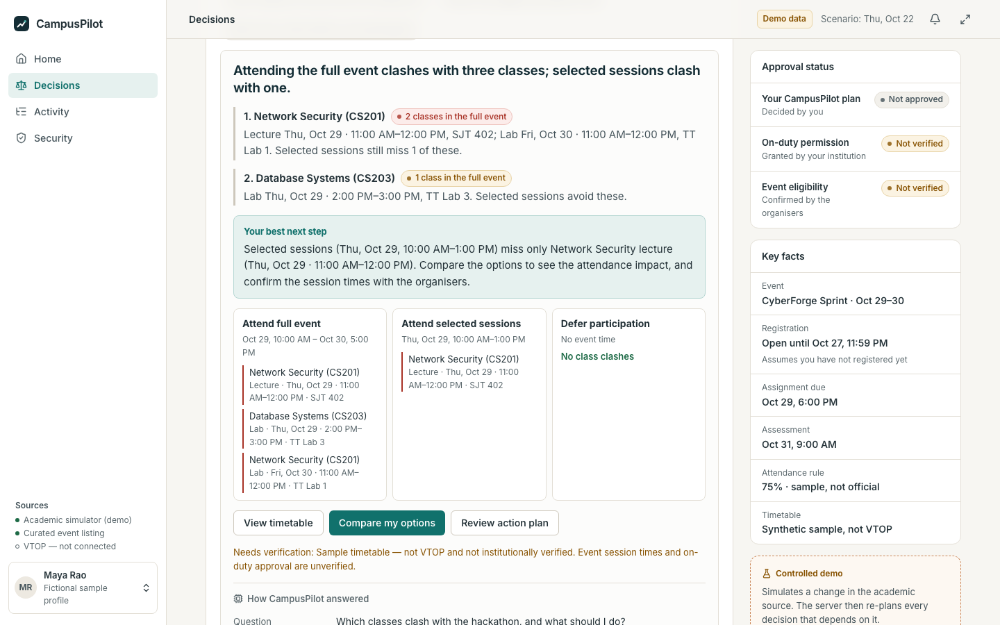

In this MVP a student is considering a two-day cybersecurity hackathon. CampusPilot:

1. lets the student **ask a question**. A **local language model** (`llama3.2:1b`, running on the
   same computer) decides what the question is about and which of the student's records to check.
2. reads the (synthetic) records through **permission-scoped, read-only tools**.
3. computes the consequences of three choices with a **deterministic engine**: attendance
   projections, class clashes, deadline conflicts and the registration window.
4. recommends one option **conditionally**, keeping visible what must still be verified.
5. saves the action plan as local tasks **only after the student approves** that exact plan revision.
6. **replans by itself** when a source record changes, and invalidates the old approval.

The model chooses *how to investigate*. It never produces the numbers.

> **Honesty first.** The student (Maya Rao), "Test Student B", CyberForge Sprint, the academic
> records, the timetable and the 75% threshold are all fictional. CampusPilot is **not** connected to
> VTOP or any university system. The model only routes questions to read-only tools; every number
> comes from ordinary, tested code.

## Screens

| | |
|---|---|
| 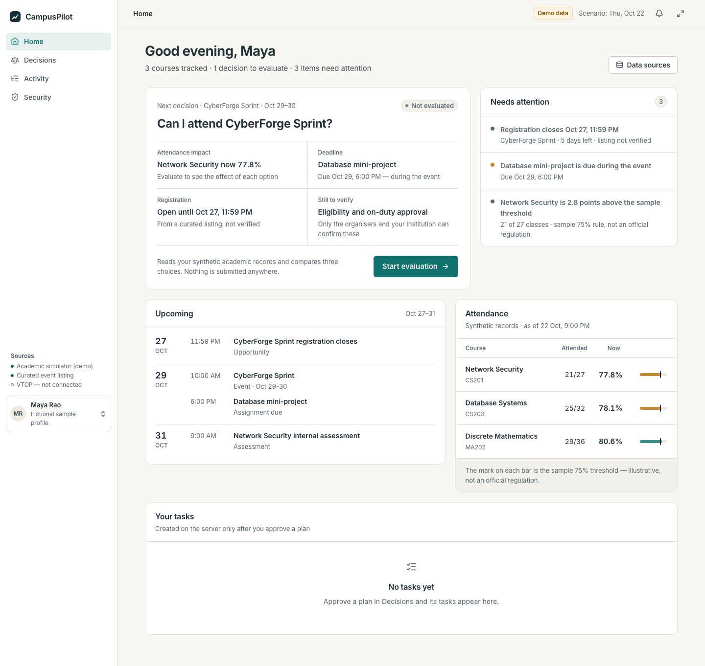 **Home**: what needs attention, from synthetic records | 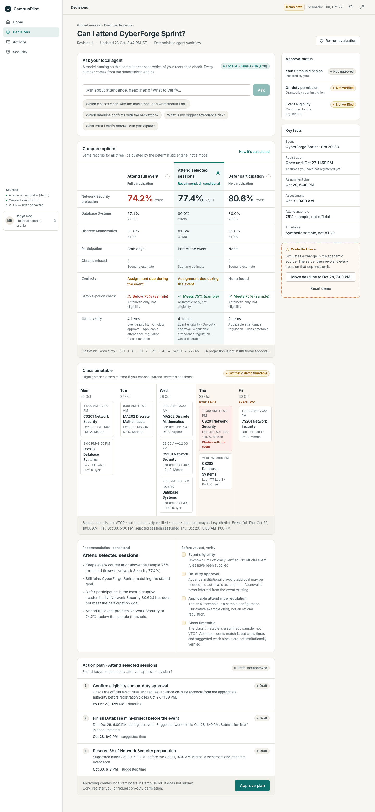 **Decisions**: three options computed by the engine (74.2 / 77.4 / 80.6%) and a conditional recommendation |
| 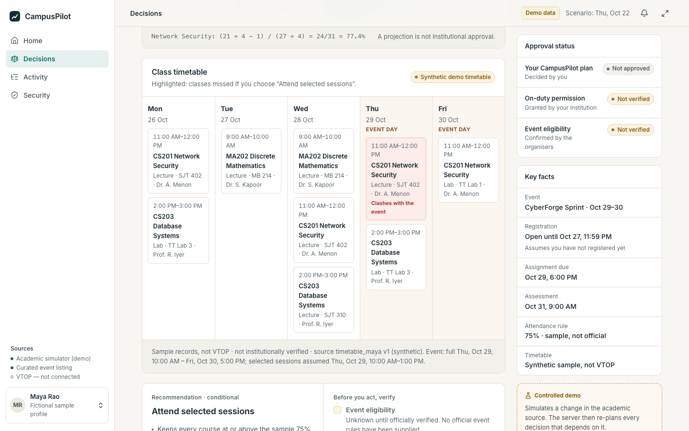 **Timetable**: the class missed under "selected sessions", by real interval overlap | 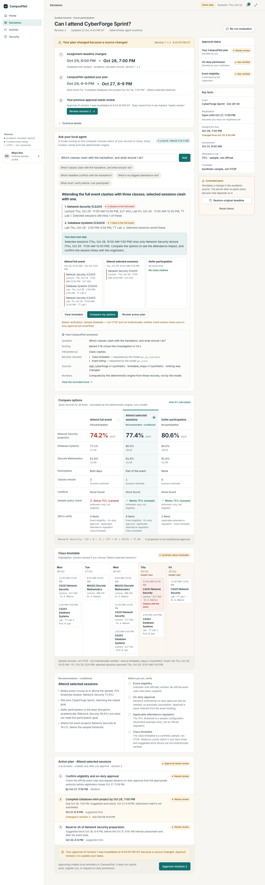 **Replanning**: deadline moved → revision 2, work block moved, approval invalidated |
| 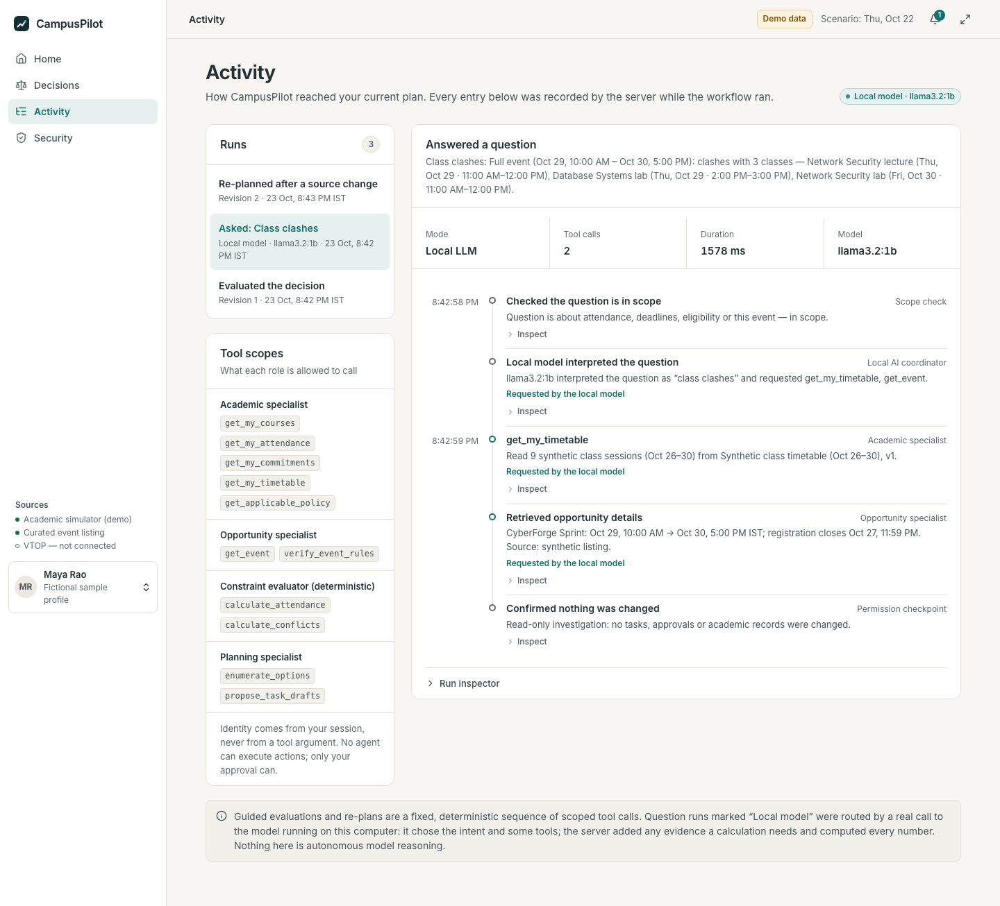 **Activity**: the recorded `local_llm` run, with each tool marked "requested by the local model" | 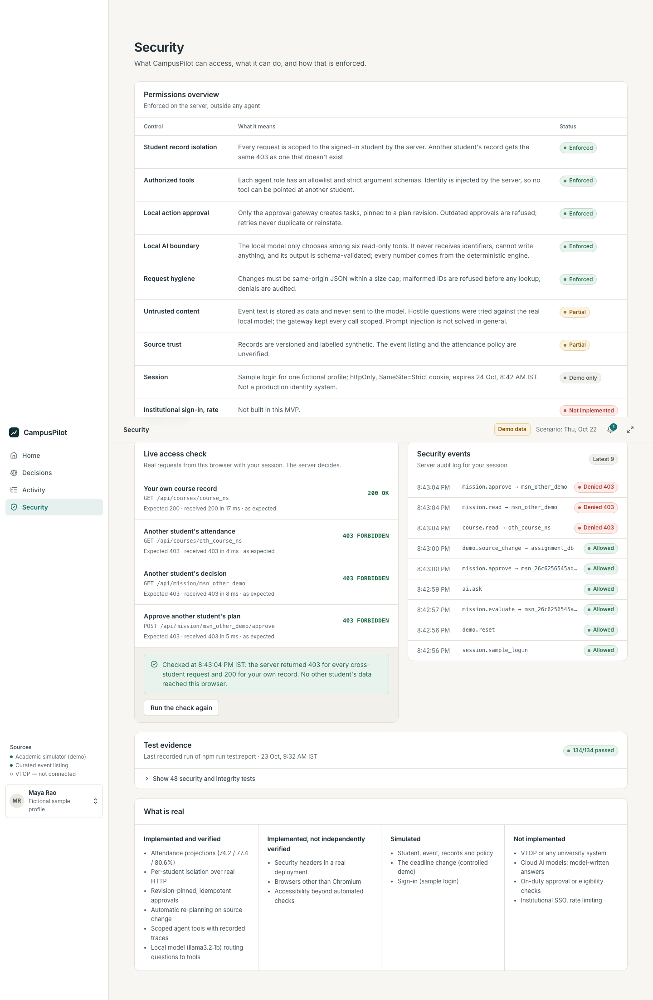 **Security**: live access check; real 403s for another student's records |
| 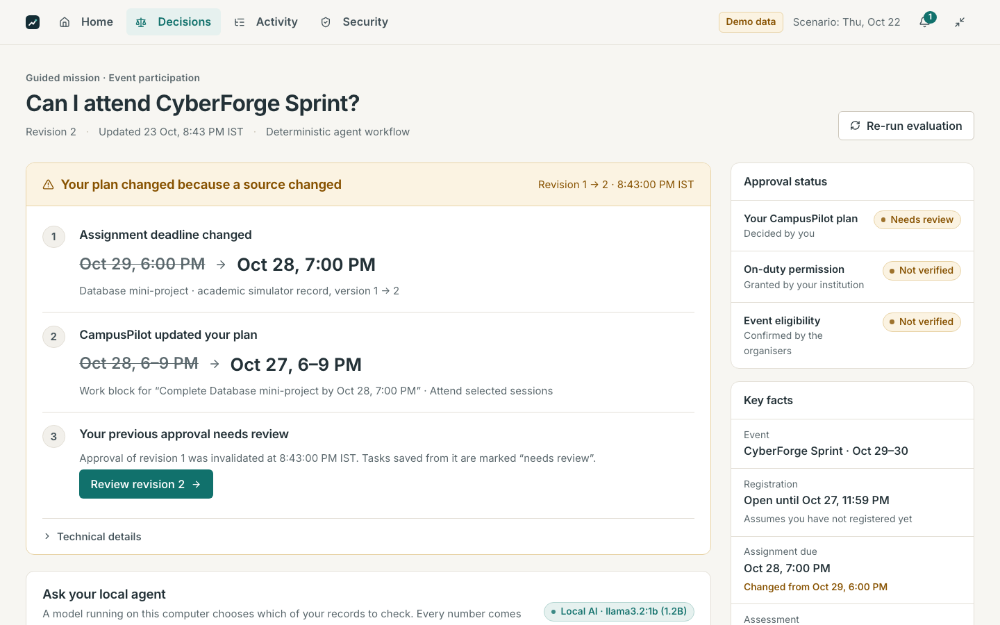 **Presentation mode (P)**: the sidebar hides and a top-bar navigation appears | 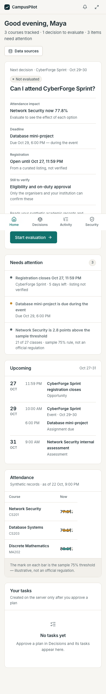 **Mobile** (390 px) |

**Opening sequence** (`/overview?intro=1`, 30 s, replays on every load):

| | | | |
|---|---|---|---|
| 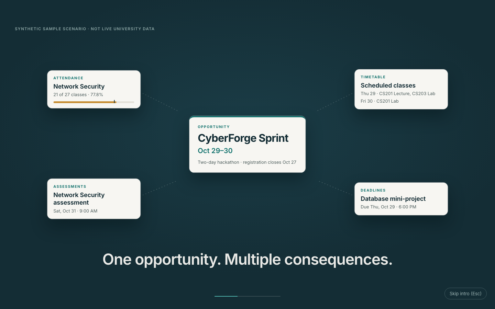 | 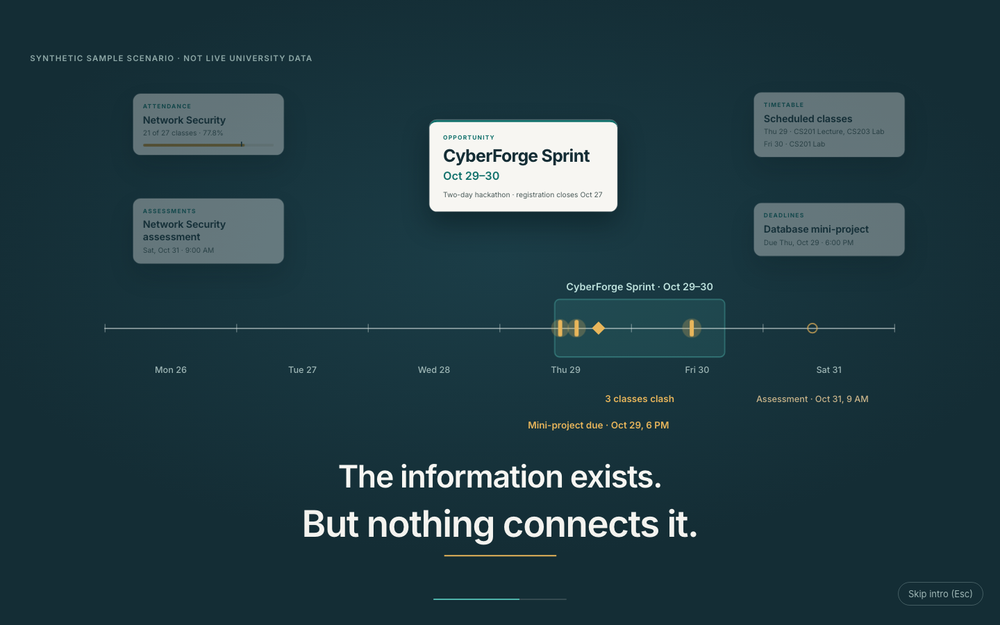 | 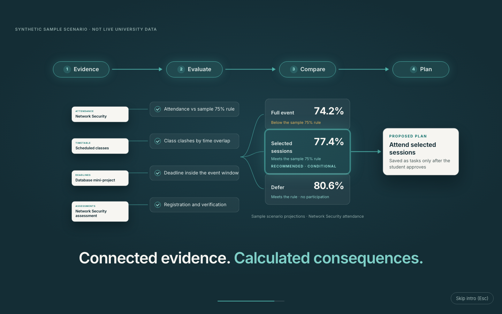 | 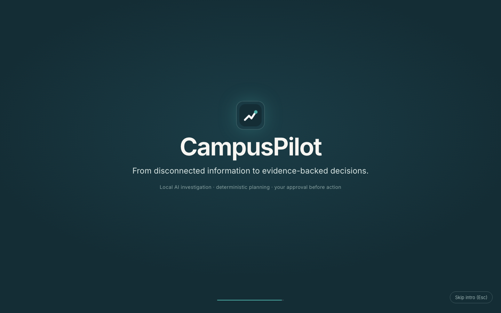 |

All screenshots come from `npm run screenshots` against a production build with the real local
model. More sizes are in [`docs/screenshots/v2`](docs/screenshots/v2); v1 is in `docs/screenshots/v1`.

## PS2 and Track 1 at a glance

PS2 names "areas *such as* resource optimization, security, energy management and student services".
We state our coverage of each area without claiming that every area is mandatory:

| Area / capability | In this prototype |
|---|---|
| Student services | **Implemented** for one scenario (event participation), end to end |
| Security | **Limited**: application and academic-data security (isolation, consent, audit), not physical campus security |
| Resource optimization | **Limited**: one student's time and attendance, not rooms, labs or staff |
| Energy management | **Not implemented** |
| Reasoning · Planning · Tool usage · Task execution | Hybrid (the model routes, rules decide) · implemented · implemented · local tasks only |

Details and evidence:

- [`docs/ROUND2_PS2_COMPLIANCE.md`](docs/ROUND2_PS2_COMPLIANCE.md)
- [`docs/round2/`](docs/round2/README.md): matrix, test results, live-model routing
- [compliance report PDF](docs/report/CampusPilot_PS2_Implementation_Compliance_Report.pdf)

## Run it

Requires Node.js **≥ 22.13** (built-in `node:sqlite`; developed and tested on Node 24).

```bash
npm install
npm run demo         # production build + start on http://localhost:3000 (use for the showcase)
npm run dev          # development server
```

**Local AI (optional):** install [Ollama](https://ollama.com) and `ollama pull llama3.2:1b`
(already installed on the presentation Mac). Without it, everything still works and the Ask panel
is labelled "Offline · keyword fallback". Configuration: `.env.example`, details in
`docs/AI_ARCHITECTURE.md`.

1. Open http://localhost:3000 → **Open Maya's sample workspace**.
2. Press **P** for presentation mode (sidebar hides, type scales up, and a compact Home · Decisions ·
   Activity · Security navigation appears in the top bar).
3. Reset between rehearsals: **Decisions → Controlled demo → Reset demo** (or `npm run db:reset`
   with the server stopped).

**Offline fallback (no Node at all):** open `prototype/index.html` — the untouched v1 static
prototype from the build kit.

## What is real

| | Capability |
|---|---|
| **Real local-model inference** | `llama3.2:1b` (Ollama 0.35.1, loopback) interprets the student's question into one of seven intents (six answerable plus `unsupported`) and selects read-only tools via schema-constrained JSON; recorded as `mode=local_llm` with the model name in the trace. Verified by `npm run ai:smoke` (`reports/ai-smoke.json`) and `e2e/ai-live.spec.ts` on the presentation Mac. |
| **Deterministic backend (verified by tests)** | Attendance projections 74.2 / 77.4 / 80.6% · conflicts · registration status · conditional recommendation · per-student isolation over real HTTP · revision-pinned idempotent approvals · local task execution with read-back · source change → replan → approval invalidated · scoped tool gateway · WCAG 2.1 A/AA automated scans · 320–1440 px layouts |
| **Implemented, not independently verified** | Security headers in a real deployment · browsers other than Chromium · manual screen-reader use · routing quality beyond the tested questions |
| **Synthetic demo data** | Student, second test profile, event, academic records, class timetable (Oct 26–30), 75% policy · the deadline change (controlled demo) · sign-in (sample login) |
| **Not implemented** | VTOP / ERP integration · cloud AI models · model-written answers (off: unreliable at 1B) · on-duty approval or eligibility verification · institutional SSO · rate limiting · energy management · institution-wide operations (rooms, labs, staff) · physical campus security |

## Routes

| Route | Label | What it shows |
|---|---|---|
| `/overview` | Home | Derived summary, next decision, what needs attention, timeline, attendance vs the sample threshold, server tasks. |
| `/decisions` | Decisions | **Ask your local agent** (model status, question, interpreted intent, records checked — by the model or added by the server — findings, unknowns, sources, trace link) · guided mission · comparison table · conditional recommendation · action plan and approval · a rail separating plan approval from on-duty permission and eligibility · the three-step replanning update. |
| `/agents` | Activity | Recorded runs: question runs show the model, its decision and each tool call (requested by the model or the server); guided runs are labelled deterministic. |
| `/trust` | Security | Permissions overview (incl. the local-AI boundary), live access check (real 403s), audit log, test evidence, what is real. |

`/overview?intro=1` plays the presentation opening over Home. Press Esc to skip it.
Visual review notes: `docs/VISUAL_REVIEW.md`.

## Architecture

```
Browser (React; server-rendered first paint; 5 s polling)
   │  same-origin JSON · httpOnly SameSite=Strict session cookie
   ▼
Next.js route handlers ── student id only from the session
   ├─ Local AI (lib/ai): scope check → llama3.2:1b routing (JSON schema) → validated tool plan
   │      └─ Ollama on 127.0.0.1 (server-side only)
   ├─ Orchestrator (lib/agents/orchestrator.ts): fixed guided workflow
   ├─ invokeTool() gateway (lib/agents/tools.ts): role allowlists · strict schemas · call budget ·
   │      server-injected identity · one trace event per call
   ├─ Engine (lib/core): attendance, conflicts, registration, options, ranking, diff
   ├─ Approval gateway (lib/server/services.ts): the only code that executes actions
   ├─ Source simulator → SOURCE_UPDATED → replan dependent missions
   └─ SQLite (node:sqlite, WAL, schema v3 with migrations)
```

### API

| Method & path | Notes |
|---|---|
| `POST /api/ai/ask` `{question}` | Local AI. Session owner only; 429 if a question is already running. |
| `GET /api/ai/status`, `POST /api/ai/warmup` | Model availability (`local_model_ready` / `_unavailable` / `_error`) and preload. |
| `POST /api/session/sample`, `POST /api/session/logout` | Demo sign-in (no identity input) / sign-out. |
| `GET /api/workspace`, `GET /api/students/me` | Session owner's snapshot. |
| `GET /api/courses/:id` | Own course or uniform 403. |
| `POST /api/mission/evaluate` `{missionType: "event_participation", opportunityId}` | Guided mission. |
| `GET /api/mission/:id`, `POST /api/mission/:id/approve`, `POST /api/mission/:id/recalculate` | Owner only; approvals: 409 stale/superseded/reused key, 422 infeasible, 403 consent/forged/foreign. |
| `GET /api/tasks`, `GET /api/trace/:runId` | Owner only. |
| `POST /api/demo/source-change`, `POST /api/demo/reset` | Demo mode only. |
| `GET /api/test-report` | Last recorded `npm run test:report`. |

## Security controls

| Threat | Control | Verified by |
|---|---|---|
| Cross-student read/write | Owner filter everywhere; identity only from the session; uniform 403; audited | backend tests, real-HTTP e2e, live check in Security |
| Model misuse / prompt injection | Model sees only the question; reply limited to intent + tool names; strict parse (extra fields rejected); read-only tool allowlist; server sets all arguments | `tests/ai.test.ts`, hostile questions in `ai:smoke` against the real model |
| Stale or replayed approval | Revision + consent checked before any idempotent replay; superseded approvals never reinstated | backend regression tests |
| Infeasible approval | Options with a hard violation cannot be approved (422) | `tests/registration.test.ts` |
| Oversized / cross-site input | 16 KB cap on the actual body stream (not just Content-Length), same-origin JSON, `Sec-Fetch-Site` check, ID format check | backend tests |
| Runaway inference | Loopback-only runtime URL, timeouts, ≤3 model calls, one question at a time | `tests/ai.test.ts` |

Prompt injection is not "solved": the guarantee is that every tool call is scoped by the server,
whatever the model outputs. Sample login is not production identity.

## Tests

```bash
npm run typecheck
npm test                 # Vitest (CI): engine, backend routes, agents, AI (mocked model), presentation
npm run build
npm run test:e2e         # Playwright on a production build (local model switched off)
npm run ai:smoke         # REAL model over HTTP against a running app (BASE=http://localhost:3000)
AI_LIVE=1 npx playwright test e2e/ai-live.spec.ts   # REAL model through the browser
npm run screenshots      # six viewport sizes; uses the real model if running
```

Results observed on 23 Oct 2026 on the presentation Mac, with pass, fail and skip counts and the live-model
routing table, are in [`docs/round2/FINAL_TEST_RESULTS.md`](docs/round2/FINAL_TEST_RESULTS.md).
The real-model smoke run is in `reports/ai-smoke.json`.

## Accessibility

Landmarks and a skip link; semantic tables; labelled inputs; `aria-pressed`/`aria-current`;
accessible dialog (focus in, trapped, restored); status never conveyed by colour alone; 12 px
minimum text; WCAG AA contrast (axe-core scans pass on every screen at 1440 and 390 px);
`prefers-reduced-motion`; presentation mode scales all rem-based sizes.

## Documentation

- [`docs/AI_ARCHITECTURE.md`](docs/AI_ARCHITECTURE.md): how the local model is used and constrained
- [`docs/ROUND2_PS2_COMPLIANCE.md`](docs/ROUND2_PS2_COMPLIANCE.md) and [`docs/round2/`](docs/round2/README.md): coverage, tests and evidence
- [`docs/report/`](docs/report/): PS2 implementation and compliance report (PDF and Markdown)
- [`PITCH_NOTES.md`](PITCH_NOTES.md): 3-minute demo script

## Limitations

- The local model routes six kinds of question about one event; off-topic questions are refused.
  It mis-routes some paraphrases; the server still gathers the evidence each intent needs.
- One supported guided mission (event participation); the demo assumes the student has not
  registered for the event yet.
- Planning uses the seed's scenario clock (22 Oct 2026, 9:00 PM IST); real timestamps are used for
  approvals, audit, traces and source updates.
- Suggested work blocks are proposals; the class timetable is synthetic sample data (not VTOP), and the missed-class counts agree with it (unit-tested).
- One process, one SQLite file, CPU inference — a local demo, not a deployment.
